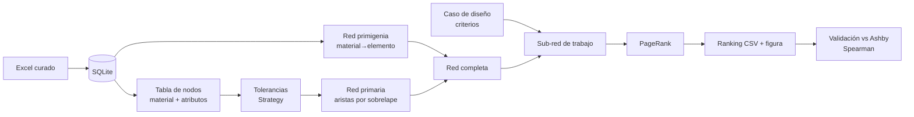

# SMO — Documento de diseño del PMV

Versión 0.1 · 01/10/2026 · Autor: Franco (con asistencia de Claude)

Versión liviana de la metodología de Ingeniería de Software (pasos 1 a 6). Los pasos 7 a 10 se reflejan en el repositorio: git, código, pruebas y notebook.

---

## 1. Problema y alcance

**Problema.** Se busca seleccionar materiales para una aplicación con la lógica de Ashby: requisitos de diseño → propiedades relevantes → ranking de candidatos. En lugar de cartas e índices, la colección de materiales se modela como una red y el ranking lo hace PageRank (proyecto "Gemas"/SMO, PIDTA SeCyT‑UNC 2026).

**Objetivo del PMV.** Mostrar el método completo funcionando sobre las aleaciones de Al, de punta a punta y reproducible, y compararlo con un índice de Ashby. El resultado es material para la versión final de Argencon 2026 y para el póster.

| Dentro del alcance | Fuera del alcance |
|---|---|
| Aleaciones de Al de la BD curada (`aleaciones_al_BD.xlsx`) | Ti y aceros |
| Atributos: E, Rp0,2, densidad, α, T sólidus | Precio (no hay datos) |
| Red primigenia (composición) y red primaria (atributos) | Interfaz gráfica / web |
| Selección por criterios + PageRank | Optimización del parámetro d |
| Validación contra índices de Ashby | Completar datos faltantes de la BD |

**Límite del sistema.** Entrada: el Excel de la BD y un archivo de configuración. Salida: rankings (CSV), métricas de validación y figuras (PNG).

## 2. Requerimientos

### Funcionales
| ID | Requerimiento | Cómo se verifica |
|---|---|---|
| RF1 | Generar la BD SQLite a partir del Excel curado | Test: tablas y cantidad de filas |
| RF2 | Armar la tabla de nodos (material + atributos), excluyendo los nodos con datos incompletos | Test: sin NaN en los atributos |
| RF3 | Asignar a cada nodo una tolerancia por atributo según la estrategia configurada | Test: tolerancia > 0 |
| RF4 | Construir la red primigenia: material → elemento de aleación | Test: 7075 conectado a Zn, Mg y Cu |
| RF5 | Construir la red primaria: una arista por cada atributo cuyas vecindades se sobrelapan, orientada hacia el valor creciente | Test: caso de 3 nodos armado a mano |
| RF6 | Extraer la sub‑red de trabajo según los criterios (atributos relevantes y si se maximizan o minimizan) | Test: solo quedan aristas de los atributos elegidos |
| RF7 | Rankear la sub‑red con PageRank y devolver solo materiales (sin elementos) | Test: las probabilidades suman 1 |
| RF8 | Comparar los puestos del ranking PageRank y del índice de Ashby mediante Spearman | Test: los puestos coinciden con el cálculo manual |
| RF9 | Exportar el ranking (CSV) y una figura de la red | Los archivos existen después de correr |

### No funcionales
| ID | Requerimiento | Por qué |
|---|---|---|
| RNF1 | **Configurable**: las decisiones abiertas son parámetros en `config/config.yaml`, no código | No hay acceso a Lautaro: el PMV no puede bloquearse por esas decisiones |
| RNF2 | **Reproducible**: un comando regenera todo desde el Excel | Requisito académico (paper) |
| RNF3 | **Entendible**: código comentado en español y en módulos chicos | El equipo no entendió el código de las frutas generado por un chatbot |
| RNF4 | **Trazable**: git, y cada supuesto documentado | Gestión de configuración (paso 7) |
| RNF5 | **Extensible**: agregar Ti o acero no debe obligar a cambiar el núcleo | Prototipo con Al, Ti y acero previsto |

Desempeño, seguridad y disponibilidad no son críticos: son unos 50 nodos y una sola persona usándolo.

## 3. Modelado (diagrama de actividades del flujo)

Es el flujo del laboratorio (minuta del 27/11/2025): Datos crudos → Datos curados → Objetos → Base de datos → Red.

## 4. Arquitectura

**Pipes & Filters.** Cada etapa es un módulo con una función pura (entra un DataFrame o un grafo, sale otro). Se eligió porque el laboratorio ya pensó el problema como un flujo de etapas (RNF3) y porque permite probar cada etapa por separado (RF1–RF9).

| Módulo (`src/smo/`) | Responsabilidad |
|---|---|
| `config.py` | Leer y validar `config.yaml` |
| `repositorio.py` | Crear y consultar la BD SQLite (Repository) |
| `nodos.py` | Armar la tabla de nodos (Strategy de granularidad) |
| `tolerancias.py` | Calcular las vecindades (Strategy) |
| `redes.py` | Red primigenia, red primaria y red completa |
| `seleccion.py` | Criterios, sub‑red de trabajo, PageRank |
| `validacion.py` | Índices de Ashby y correlación de Spearman |
| `visualizacion.py` | Figuras |
| `pipeline.py` | Orquestación y línea de comandos |

## 5. Patrones y decisiones de diseño

| Patrón | Dónde | Razón |
|---|---|---|
| Pipes & Filters | Flujo general | Igual al flujo del laboratorio; cada etapa se prueba por separado |
| Repository | `repositorio.py` | Aísla SQL del resto: si cambia la BD (Ti, acero), solo cambia este módulo (RNF5) |
| Strategy | Granularidad del nodo, tolerancias, orientación de la primigenia | Cada decisión abierta tiene implementaciones intercambiables desde la configuración (RNF1) |

### Decisiones por defecto del PMV (a revisar con Lautaro)
| ID | Decisión abierta | Valor por defecto | Alternativas implementadas |
|---|---|---|---|
| D1 | Nodo = aleación o aleación + temple | `aleacion_estado`; el caso de rigidez usa `aleacion` | Se puede pisar por caso |
| D2 | Origen de las tolerancias | `rango`: ±10 % del rango del atributo | `porcentual`, `absoluta` |
| D3 | Orientación de la red primigenia | `hacia_elemento` (como en las minutas) | `bidireccional`, `ninguna` |
| D4 | Elementos en el ranking | Excluidos (se renormaliza) | — |
| D5 | Parámetro de PageRank | α = 0,85 (d = 0,15 en la notación del paper) | Cualquier valor |
| D6 | Datos marcados como dudosos | Excluidos | Incluidos |
| D7 | Qué elemento cuenta como "aleante" | Tiene mínimo especificado en la norma (los "≤x" son impurezas) y contenido nominal ≥ 0,1 % | Cualquier umbral |
| D8 | Propiedades físicas por temple | Se suponen independientes del temple (E, ρ, α y T sólidus dependen de la composición) | — |
| D9 | Ponderación de aristas | `por_atributo`: cada criterio pesa igual | `uniforme` (cada arista pesa 1) |
| D10 | ¿La primigenia participa de la selección? | Sí | No |

**Nota sobre d.** En el paper, d es la fracción de **teletransporte**: G = (1−d)·Σ + d/N. En networkx, `alpha` es la fracción que **sigue aristas**. Por eso d = 1 − alpha: el valor genérico "0,85" del paper corresponde en realidad a alpha = 0,85, es decir d = 0,15. Conviene aclararlo en la versión final.

## 6. Planificación

| Sprint | Contenido | Prioridad |
|---|---|---|
| 0 | Estructura, git, este documento | Alta |
| 1 | BD, nodos, tolerancias, redes (RF1–RF5) | Alta |
| 2 | Sub‑red y PageRank (RF6–RF7) | Alta |
| 3 | Validación Ashby y figuras (RF8–RF9) | Alta |
| 4 | Notebook demo, README, decisiones abiertas | Media |
